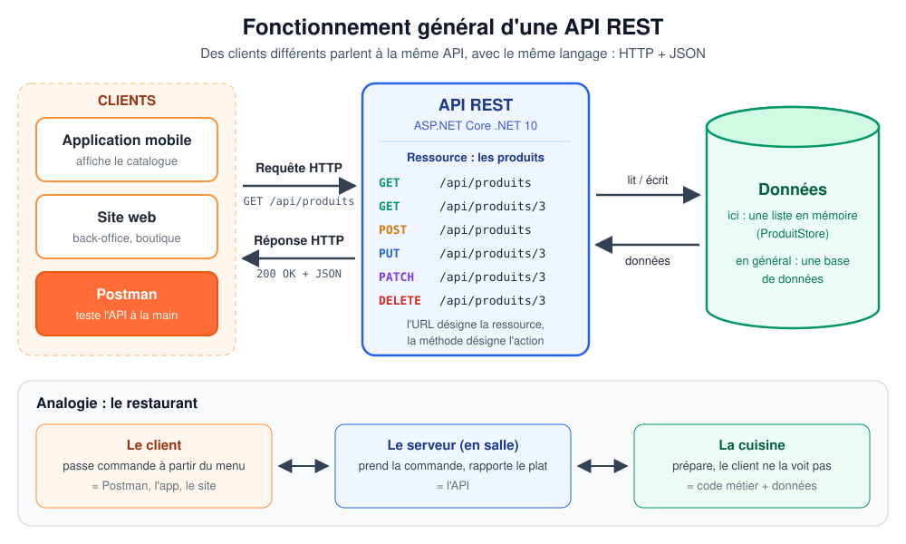

# Formation Postman et API REST — kit clé en main

> **🛟 Branche `net8` : version de secours en .NET 8.**
> Elle est destinée aux postes qui n'ont que le SDK .NET 8 (erreur `NETSDK1045 : le SDK .NET actuel ne prend pas en charge le ciblage .NET 10.0`).
> La version de référence du kit est en **.NET 10**, sur la branche `main`.
> Différences avec `main` : projet ciblant `net8.0`, paquet `Microsoft.AspNetCore.Authentication.JwtBearer` 8.0.33, pas d'endpoint `/openapi/v1.json` (bonus facultatif du cours). Tout le reste est identique : endpoints, codes de réponse, messages d'erreur, collection et environnement Postman (37 requêtes, 110 tests réussis).
> Dans les documents, lire « .NET 8 » partout où il est écrit « .NET 10 ».

Kit complet pour animer une formation **pratique** d'au moins **1 heure** (programme principal : **1 h 30**) destinée à un **débutant** : comprendre les API REST et le protocole HTTP, et maîtriser l'essentiel de **Postman**.

Le kit contient :
- une **API de démonstration en C# / ASP.NET Core .NET 10** (gestion de produits, en mémoire, authentification Bearer Token) ;
- une **solution Visual Studio** (`FormationPostman.sln`) prête à lancer et à déboguer ;
- une **collection Postman** de 37 requêtes **avec tests**, et son **environnement** ;
- un **support de cours** complet, un **programme minuté**, **9 schémas**, des **exercices corrigés**, une **fiche récapitulative** et une **checklist**.



---

## Démarrage rapide (5 minutes)

**Prérequis :** SDK .NET 10 + Visual Studio 2026 (ou toute autre manière de lancer `dotnet`), Postman (application de bureau) avec un compte. Détails : [docs/01-installation-et-lancement.md](docs/01-installation-et-lancement.md).

1. **Lancer l'API**
   - Visual Studio : ouvrir `FormationPostman.sln`, profil **`http`**, **F5**.
   - Ou en ligne de commande :
     ```bash
     cd src/ProduitsApi
     dotnet run
     ```
   L'API écoute sur **http://localhost:5080** (le navigateur affiche un JSON de bienvenue).

2. **Configurer Postman**
   - **Import** > glisser les deux fichiers du dossier [`postman/`](postman/).
   - En haut à droite, sélectionner l'environnement **Formation API REST - Local**.

3. **Vérifier**
   - Envoyer *00 - Démarrage > Ping* → `200 OK`.
   - Clic droit sur la collection > **Run collection** → **37 requêtes, 110 tests réussis**.

**Comptes de démonstration :** `admin` / `Admin123!` (rôle Admin) et `alice` / `Alice123!` (rôle Utilisateur, ne peut pas supprimer).

---

## Contenu du kit

| Livrable | Fichier |
|---|---|
| 1. Support de cours complet et structuré (14 chapitres) | [docs/03-support-de-cours.md](docs/03-support-de-cours.md) |
| 2. Programme pédagogique détaillé (1 h 30, variante 60 min) | [docs/02-programme-de-la-formation.md](docs/02-programme-de-la-formation.md) |
| 3. Schémas explicatifs (9 SVG commentés) | [docs/04-schemas.md](docs/04-schemas.md) et [docs/schemas/](docs/schemas/) |
| 4. Projet complet de l'API C# .NET 10 | [FormationPostman.sln](FormationPostman.sln) et [src/ProduitsApi/](src/ProduitsApi/) |
| 5. Instructions pour lancer l'API en local | [docs/01-installation-et-lancement.md](docs/01-installation-et-lancement.md) |
| 6. Collection Postman (JSON) | [postman/Formation-API-REST.postman_collection.json](postman/Formation-API-REST.postman_collection.json) |
| 7. Environnement Postman (JSON) | [postman/Formation-API-REST-Local.postman_environment.json](postman/Formation-API-REST-Local.postman_environment.json) |
| 8. Exercices pratiques et corrections (+ récapitulatif et quiz) | [docs/05-exercices-et-corrections.md](docs/05-exercices-et-corrections.md) |
| 9. Fiche récapitulative (méthodes, codes, headers, Postman) | [docs/06-fiche-recapitulative.md](docs/06-fiche-recapitulative.md) |
| 10. Checklist avant la formation | [docs/07-checklist-avant-formation.md](docs/07-checklist-avant-formation.md) |
| Annexe : visite guidée du code C# | [docs/08-comprendre-le-code-de-l-api.md](docs/08-comprendre-le-code-de-l-api.md) |

**Par où commencer ?** La veille : [checklist](docs/07-checklist-avant-formation.md) → [programme](docs/02-programme-de-la-formation.md) → [support de cours](docs/03-support-de-cours.md). Le jour J : le support de cours et la collection Postman suivent le même ordre.

---

## L'API de démonstration

| Méthode | URL | Protection | Succès |
|---|---|---|---|
| GET | `/api/ping` | public | 200 |
| POST | `/api/auth/token` | public | 200 (token JWT) |
| GET | `/api/auth/moi` | token | 200 |
| GET | `/api/produits` (filtres : `categorie`, `recherche`, `prixMin`, `prixMax`, `enStock`, `tri`, `ordre`, `page`, `taille`) | public | 200 + header `X-Total-Count` |
| GET | `/api/produits/{id}` | public | 200 |
| POST | `/api/produits` | token | 201 + header `Location` |
| PUT | `/api/produits/{id}` | token | 200 |
| PATCH | `/api/produits/{id}` | token | 200 |
| DELETE | `/api/produits/{id}` | token + rôle **Admin** | 204 |
| GET | `/api/demo/headers` | public | 200 (renvoie les headers reçus) |
| GET | `/api/demo/erreur` | public | 500 volontaire |
| POST | `/api/demo/reinitialiser` | public | 200 (remet les 10 produits de démonstration) |

Codes d'erreur illustrés : **400** (validation, JSON mal formé), **401** (pas de token, token invalide ou expiré), **403** (rôle insuffisant), **404**, **405**, **409** (doublon), **415** (mauvais `Content-Type`), **500**. Toutes les erreurs sont renvoyées au format standard **ProblemDetails**, avec des **messages en français** qui expliquent la cause probable (par exemple : « Le token reçu contient '{{' : la variable Postman n'a pas été remplacée »).

**Technologies :** .NET 10, ASP.NET Core (contrôleurs), `Microsoft.AspNetCore.Authentication.JwtBearer` et `Microsoft.AspNetCore.OpenApi` (paquets officiels Microsoft), stockage en mémoire, aucune base de données.

---

## Vérifications effectuées

- `dotnet build -warnaserror` : succès, 0 avertissement (SDK .NET 10.0.1xx).
- Chaque endpoint et chaque code de réponse testés contre l'API réelle (dont l'expiration du token).
- Collection exécutée avec **Newman** (moteur en ligne de commande de Postman) : **37 requêtes, 110 assertions, 0 échec**, deux fois de suite.
- Les corrections de l'exercice 9 et de l'exercice récapitulatif ont été rejouées telles qu'écrites : 0 échec.

Pour refaire la vérification de la collection (Node.js requis, API lancée) :

```bash
npx newman run postman/Formation-API-REST.postman_collection.json -e postman/Formation-API-REST-Local.postman_environment.json
```

---

> ⚠️ **API pédagogique.** Comptes écrits en dur, clé de signature dans `appsettings.json`, HTTP sans TLS : ces simplifications sont volontaires pour la formation et ne doivent pas être reproduites en production (voir [docs/08-comprendre-le-code-de-l-api.md](docs/08-comprendre-le-code-de-l-api.md), § 8.5).
