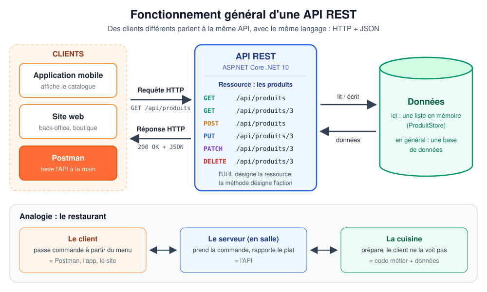
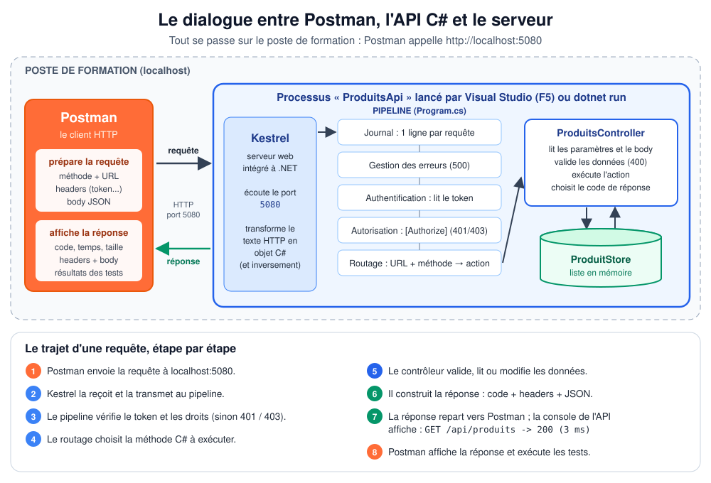
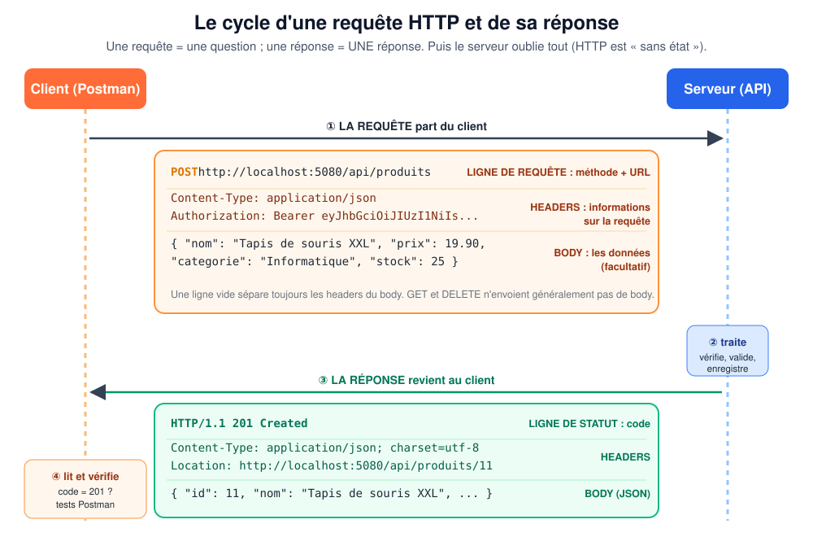
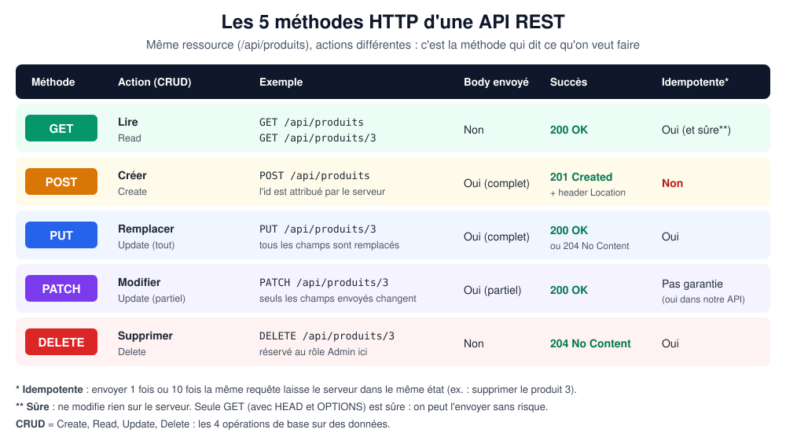
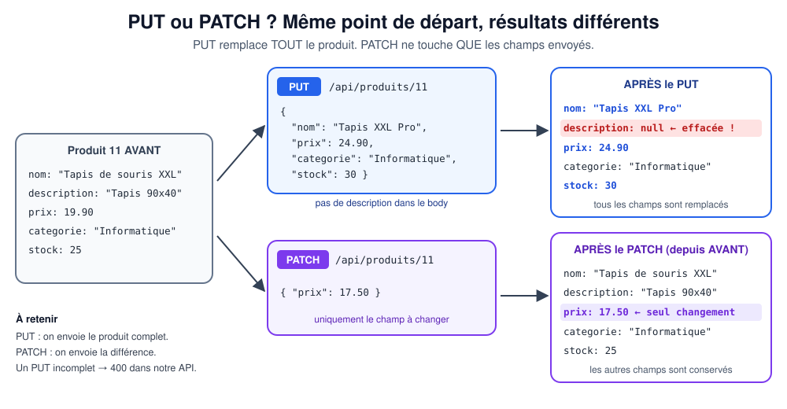
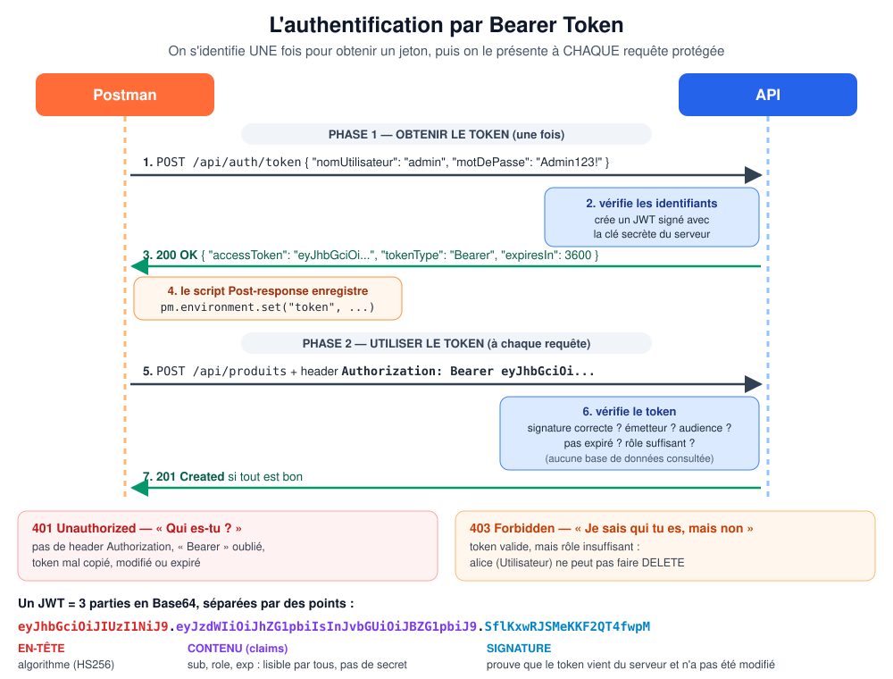
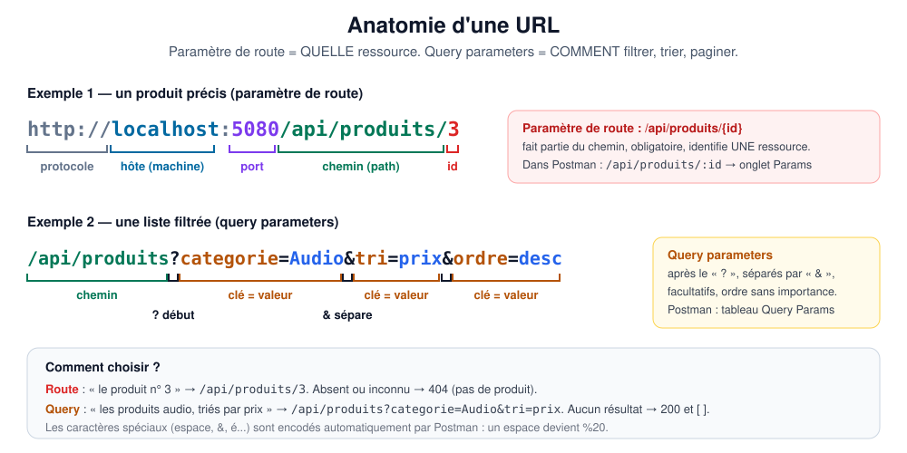
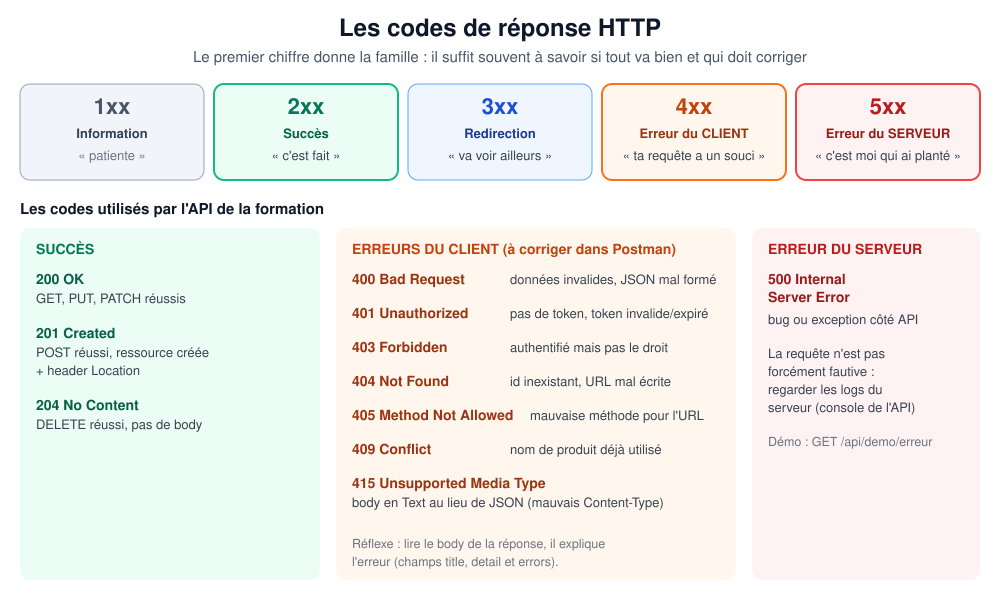
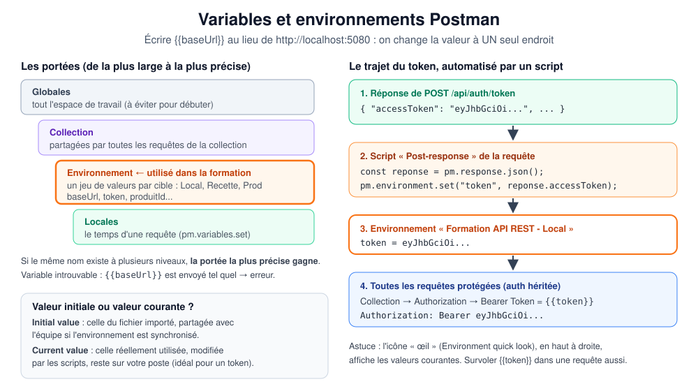

# 4. Schémas explicatifs

Les 9 schémas du kit, au format SVG (lisibles dans un navigateur, sur GitHub, dans Visual Studio ou VS Code, et insérables dans PowerPoint ou Word via *Insertion > Images*). Ils sont aussi intégrés au support de cours, au chapitre correspondant.

| # | Schéma | Fichier | Chapitre |
|---|---|---|---|
| 1 | Fonctionnement général d'une API REST | [schemas/01-api-rest-vue-generale.svg](schemas/01-api-rest-vue-generale.svg) | 1, 2 |
| 2 | Le dialogue entre Postman, l'API C# et le serveur | [schemas/02-dialogue-postman-api-serveur.svg](schemas/02-dialogue-postman-api-serveur.svg) | 3, 4 |
| 3 | Le cycle d'une requête HTTP et de sa réponse | [schemas/03-cycle-requete-reponse.svg](schemas/03-cycle-requete-reponse.svg) | 4 |
| 4 | Les 5 méthodes HTTP | [schemas/04-methodes-http.svg](schemas/04-methodes-http.svg) | 6 |
| 5 | PUT ou PATCH ? | [schemas/05-put-vs-patch.svg](schemas/05-put-vs-patch.svg) | 13 |
| 6 | L'authentification par Bearer Token | [schemas/06-authentification-bearer.svg](schemas/06-authentification-bearer.svg) | 10 |
| 7 | Anatomie d'une URL (route et query) | [schemas/07-anatomie-url.svg](schemas/07-anatomie-url.svg) | 3, 7 |
| 8 | Les codes de réponse HTTP | [schemas/08-codes-http.svg](schemas/08-codes-http.svg) | 9 |
| 9 | Variables et environnements Postman | [schemas/09-variables-postman.svg](schemas/09-variables-postman.svg) | 11 |

---

## Schéma 1 — Fonctionnement général d'une API REST

**Ce qu'il montre.** Plusieurs **clients** très différents (application mobile, site web, Postman) envoient des **requêtes HTTP** à la **même API**. L'API expose une **ressource** (les produits) au travers d'URL et de méthodes, et c'est elle seule qui accède aux **données**. Chaque client reçoit une **réponse HTTP** : un code et des données JSON.

**Comment le commenter.**
- « Peu importe la technologie du client : tous parlent le même langage, HTTP + JSON. »
- « Le client ne voit jamais la base de données. L'API est le seul point d'entrée : elle contrôle tout. »
- Lire la liste des endpoints : « l'URL désigne la ressource, la méthode désigne l'action ».
- Bandeau du bas : l'analogie du **restaurant** (client = Postman, serveur en salle = API, cuisine = code et données ; le menu = la documentation).

**Question à poser.** « Si demain on crée une application pour montre connectée, faut-il modifier l'API ? » (Non : elle réutilise les mêmes endpoints.)

---

## Schéma 2 — Le dialogue entre Postman, l'API C# et le serveur

**Ce qu'il montre.** Tout se passe sur le **poste de formation** (`localhost`). **Postman** prépare la requête et l'envoie sur le port **5080**. Dans le processus *ProduitsApi* lancé par Visual Studio :
1. **Kestrel**, le serveur web intégré à .NET, reçoit le texte HTTP et le transforme en objet C# ;
2. la requête traverse le **pipeline** défini dans `Program.cs` : journalisation, gestion des erreurs, **authentification** (lecture du token), **autorisation** (`[Authorize]`, 401/403), **routage** (quelle méthode C# appeler ?) ;
3. le **contrôleur** `ProduitsController` valide les données (400), lit ou modifie le **ProduitStore** (liste en mémoire) et choisit le code de réponse ;
4. la réponse refait le chemin inverse jusqu'à Postman, qui l'affiche et exécute les tests.

**Comment le commenter.** Montrer la **console de l'API** pendant un envoi : la ligne `GET /api/produits -> 200 (3 ms)` est écrite par l'étape « Journal ». Pour les curieux : poser un **point d'arrêt** dans `ProduitsController` (voir [01-installation-et-lancement.md](01-installation-et-lancement.md), § 1.3) et voir Postman « attendre » la réponse.

**Question à poser.** « Une requête sans token sur POST /api/produits : à quelle étape est-elle arrêtée ? » (Autorisation → 401 ; le contrôleur n'est jamais appelé.)

---

## Schéma 3 — Le cycle d'une requête HTTP et de sa réponse

**Ce qu'il montre.** Sur une ligne de temps : ① la **requête** part du client (ligne de requête *méthode + URL*, **headers**, ligne vide, **body**) ; ② le serveur **traite** ; ③ la **réponse** revient (ligne de statut avec le **code**, **headers**, **body**) ; ④ le client **lit et vérifie**. Puis le serveur oublie tout : HTTP est **sans état**.

**Comment le commenter.** Faire le lien avec l'écran de Postman : la moitié haute (méthode, URL, onglets *Headers* et *Body*) correspond au cadre orange ; la moitié basse (code, *Headers*, *Body*) correspond au cadre vert. Insister sur `Location` dans la réponse d'un POST.

**Question à poser.** « Quelles sont les trois parties d'une réponse ? » (Code, headers, body.)

---

## Schéma 4 — Les 5 méthodes HTTP

**Ce qu'il montre.** Pour chaque méthode : l'**action** et son équivalent **CRUD**, un **exemple** sur notre API, la présence d'un **body**, le **code de succès** et le caractère **idempotent** (et **sûr** pour GET). Les couleurs reprennent celles de Postman.

**Comment le commenter.**
- « Même ressource, 5 actions : seule la méthode change. »
- **Sûre** = ne modifie rien (GET). **Idempotente** = l'envoyer 1 ou 10 fois laisse le même état (PUT, DELETE ; pas POST, qui crée à chaque fois).
- POST renvoie **201 + Location** ; DELETE renvoie **204** sans body.

**Question à poser.** « Je clique deux fois sur "Commander" sur un site : quelle méthode pose problème ? » (POST : deux commandes.)

---

## Schéma 5 — PUT ou PATCH ?

**Ce qu'il montre.** Le même produit de départ reçoit soit un **PUT** (body complet **sans** description), soit un **PATCH** (`{"prix": 17.50}`). Après le PUT, la **description est effacée** (`null`) : tout a été remplacé. Après le PATCH, **seul le prix change**.

**Comment le commenter.** C'est la confusion n° 1 des débutants. Faire la démonstration en direct avec les dossiers 04 et 05 de la collection : le test *« PUT remplace tout : la description absente du body est effacée »* passe au vert.

**Question à poser.** « Je veux seulement passer le stock à 0 : quelle méthode, quel body ? » (PATCH, `{"stock": 0}`.)

---

## Schéma 6 — L'authentification par Bearer Token

**Ce qu'il montre.** Deux phases :
- **Phase 1, une fois** : ① `POST /api/auth/token` avec identifiant et mot de passe ; ② l'API vérifie et crée un **JWT signé** avec sa clé secrète ; ③ elle le renvoie (`accessToken`, `expiresIn: 3600`) ; ④ le script *Post-response* de Postman l'enregistre dans `{{token}}`.
- **Phase 2, à chaque requête protégée** : ⑤ la requête porte `Authorization: Bearer eyJ...` ; ⑥ l'API vérifie la signature, l'émetteur, l'audience, l'expiration et le rôle, **sans base de données** ; ⑦ `201 Created` si tout est bon.

En bas : les deux refus (**401** « qui êtes-vous ? » / **403** « je sais qui vous êtes, mais non ») et la **structure d'un JWT** (en-tête, contenu lisible par tous, signature).

**Comment le commenter.** Analogie du **bracelet de festival**. Montrer le token décodé sur https://jwt.io : « tout le monde peut lire le contenu, personne ne peut le modifier sans casser la signature ».

**Question à poser.** « Pourquoi ne met-on jamais de mot de passe dans un JWT ? » (Son contenu est lisible par n'importe qui.)

---

## Schéma 7 — Anatomie d'une URL

**Ce qu'il montre.** Exemple 1 : `http://localhost:5080/api/produits/3` découpée en **protocole**, **hôte**, **port**, **chemin** et **paramètre de route** (l'identifiant). Exemple 2 : `/api/produits?categorie=Audio&tri=prix&ordre=desc` avec le **`?`** qui ouvre les **query parameters**, les paires **clé = valeur** et le **`&`** qui les sépare. En bas : comment choisir entre les deux.

**Comment le commenter.** Faire le lien avec l'onglet **Params** de Postman : *Path Variables* (`:id`) et *Query Params* (tableau qui se synchronise avec l'URL).

**Question à poser.** « Les produits Bureau à moins de 50 € : route ou query ? » (Query : `?categorie=Bureau&prixMax=50`.)

---

## Schéma 8 — Les codes de réponse HTTP

**Ce qu'il montre.** Les **5 familles** (1xx à 5xx) avec une phrase-image, puis les **codes utilisés par notre API** : succès (200, 201, 204), erreurs du client (400, 401, 403, 404, 405, 409, 415) et erreur du serveur (500).

**Comment le commenter.** « Le premier chiffre dit **qui doit corriger** : 4xx, c'est vous (la requête) ; 5xx, c'est le serveur. » Rappeler le réflexe : **lire le body** de l'erreur (`title`, `detail`, `errors`).

**Question à poser.** « Vous recevez un 500 : faut-il modifier la requête ? » (Non : signaler le problème avec le `traceId`.)

---

## Schéma 9 — Variables et environnements Postman

**Ce qu'il montre.** À gauche, les **portées** des variables (globales, collection, environnement, locales) : la plus précise gagne. Encadré : **valeur initiale** (partagée) et **valeur courante** (utilisée, locale). À droite, le **trajet automatique du token** : réponse JSON → script `pm.environment.set("token", ...)` → variable d'environnement → header `Authorization` de toutes les requêtes qui héritent de l'authentification de la collection.

**Comment le commenter.** Ouvrir l'icône **œil** avant et après *Obtenir un token* : la valeur courante de `token` apparaît. Puis montrer l'onglet **Authorization** de la collection (`Bearer Token` = `{{token}}`).

**Question à poser.** « Demain l'API est déployée sur un serveur de recette : que faut-il changer dans les 37 requêtes ? » (Rien : créer un environnement *Recette* avec un autre `baseUrl`.)

---

## Utiliser les schémas hors du kit

- **Projection** : ouvrir le fichier `.svg` dans un navigateur (glisser-déposer), puis **F11** (plein écran) et **Ctrl + molette** pour zoomer.
- **PowerPoint / Word** : *Insertion > Images > Cet appareil* et choisir le fichier `.svg` ; il reste net à toutes les tailles.
- **Impression** : depuis le navigateur, *Imprimer* en orientation **paysage**.
